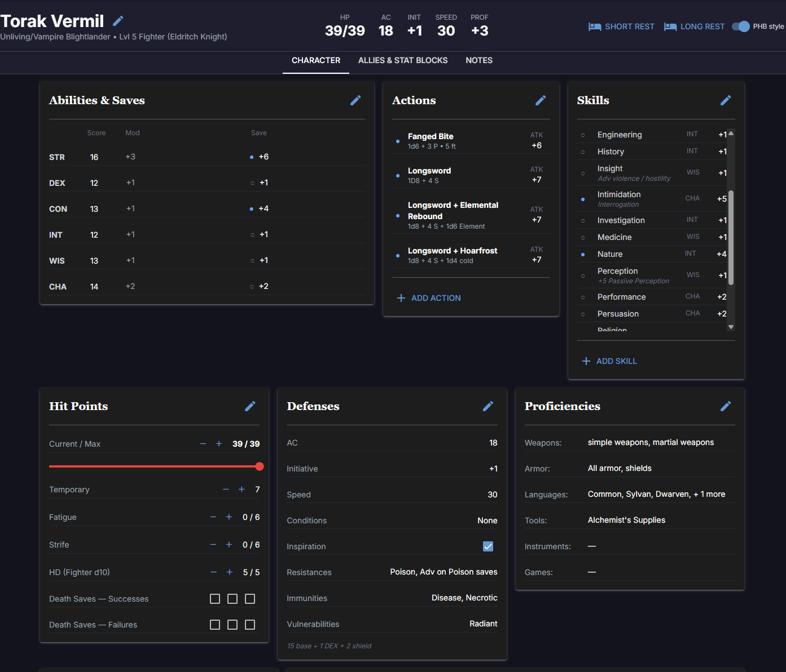
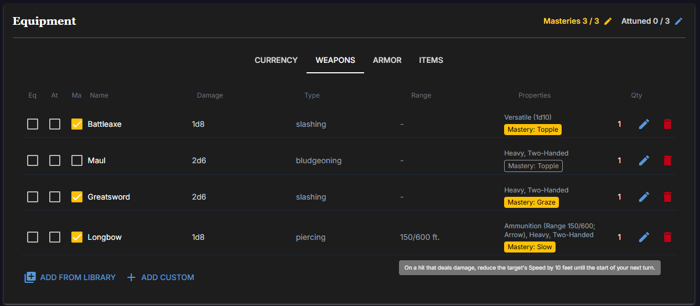
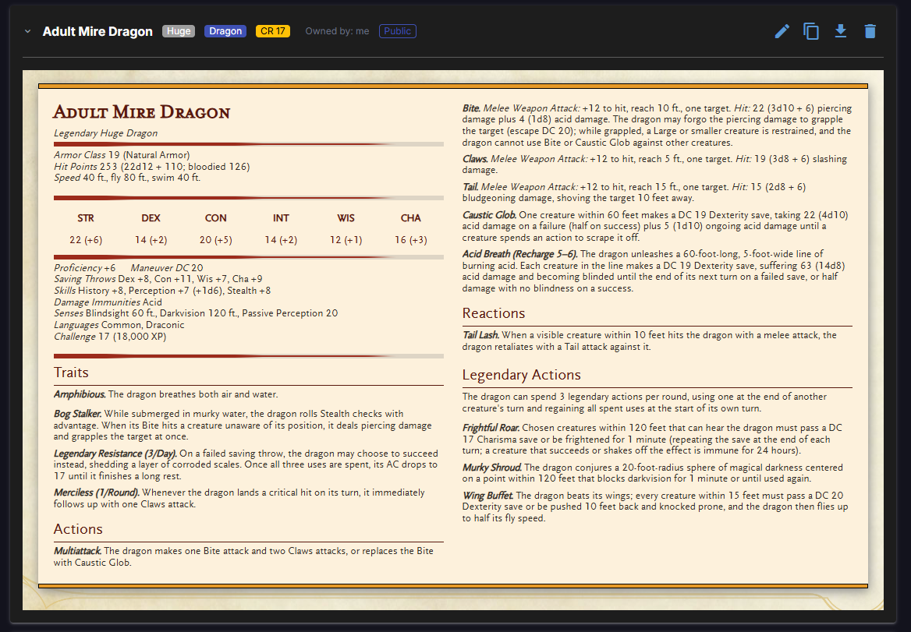

# DonjonDocs

**A home for your tabletop characters, and your monsters too.**

DonjonDocs is a self-hosted web app that keeps your **D&D 5e (2024 & 2014)**, **Level Up: Advanced 5e**, **Shadowdark RPG**, **Ultramodern5**, **Voidrunner**, and **Shadowrun: Anarchy 2.0** characters in one tidy place. Run it on your laptop for game night or host it for your group, sign your friends in, and put the paper sheets and scattered spreadsheets away.



*Explore more views in the **[Screenshot Gallery](docs/gallery.md)** — D&D 2024 Weapon Mastery, 2-column PHB Creature Catalog, Shadowrun: Anarchy 2.0, PHB-styled Allies & Notes, Spells, Combat Maneuvers, and the Admin Panel.*

## What it is

A *living* digital character sheet. Update an attribute and your skills, saves, AC, attack bonuses, spell DCs, dice pools, or wound thresholds recalculate in front of you. Click a checkbox and a spell slot or wound box is marked. Hit **Short Rest**, **Long Rest**, or **New Run** and the right things refresh.

Beyond the sheet, every character has tabs for **Allies & Stat Blocks** (pets, companions, wildshape forms, vehicles, drones, spirits, contacts) and **Notes** (session logs, plot hooks, backstory). Both panes accept Markdown — 5e-family sheets even include a **PHB style** switch that redraws them like an open Player's Handbook (parchment, serif body, small-caps headings).

A **Creature Catalog** sits next to your characters: your private bestiary, with one-click sharing for the rest of your group.

## What it's not

It's not a step-by-step character generator or rules-enforcing validator. It's a clean place to *store, organize, and play* the characters you've already built — nicer than paper, easy to customize, and completely under your control.

---

## Quick Start: Run It on Your Laptop for Game Night

You only need **Python 3.11+** (3.14 recommended) and **Git**. Whoever is hosting runs steps 1–5 once (~3 minutes); players just open a browser on their laptop, tablet, or phone.

### 1. Clone and create a virtual environment

```bash
git clone https://github.com/jeskritt/donjondocs.git
cd donjondocs
python -m venv .venv
```

Activate the virtual environment:

```powershell
# Windows (PowerShell)
.venv\Scripts\Activate.ps1
```

```bash
# macOS / Linux
source .venv/bin/activate
```

Install dependencies:

```bash
pip install -r requirements.txt
```

### 2. Create your `.env` file

Copy the example config:

```powershell
# Windows
copy .env.example .env
```

```bash
# macOS / Linux
cp .env.example .env
```

Generate **two different** random secret keys and paste them into `.env` for `SECRET_KEY` and `STORAGE_SECRET`:

```bash
python -c "import secrets; print('SECRET_KEY=' + secrets.token_urlsafe(64)); print('STORAGE_SECRET=' + secrets.token_urlsafe(64))"
```

Everything else in `.env.example` works out of the box for local play (SQLite database at `./donjondocs.db`, `DEBUG=true`, open registration).

### 3. Initialize the database

```bash
alembic upgrade head
```

*(On first startup, DonjonDocs automatically loads all bundled rulebook tables from `data/` into the empty database.)*

### 4. Create your admin account

```bash
python cli.py create-user --username gm --email gm@example.com --password "YourPassword123!" --role admin
```

### 5. Start the server and play

```bash
python main.py
```

Open **http://localhost:8080** in your browser and sign in!

> **Want to see populated sheets right away?**
> Go to **Characters → Import** and upload one of the sample sheets in `examples/`:
> - `examples/Torak Vermil.json` (Level Up: Advanced 5e)
> - `examples/Kestrel (SRA2).json` (Shadowrun: Anarchy 2.0)

### Sharing on Wi-Fi for table play (LAN)

Want players at the table to connect from their own laptops or tablets on your home Wi-Fi?

1. Find your laptop's local IP address (e.g., `192.168.1.42`):
   - **Windows:** run `ipconfig` and look for *IPv4 Address* under your Wi-Fi adapter.
   - **macOS / Linux:** run `ifconfig` or `hostname -I`.
2. Open `.env` and add that IP to `ALLOWED_HOSTS` (otherwise the host-header security check will reject non-localhost connections):
   ```dotenv
   ALLOWED_HOSTS=localhost,127.0.0.1,192.168.1.42
   ```
   *(For casual local-only play while `DEBUG=true`, `ALLOWED_HOSTS=*` also works — never use `*` when `DEBUG=false`.)*
3. Restart `python main.py` and share **`http://192.168.1.42:8080`** with your table. Players can register their own accounts at `/register`, or you can create accounts for them under **Admin → Admin Panel**.
4. *(Windows firewall prompt)* If Windows Defender asks whether to allow Python on Private networks, click **Allow** so devices on your Wi-Fi can reach port `8080`.

### Updating later (`git pull`)

When you pull new updates or new rulebook data later:

```bash
pip install -r requirements.txt
alembic upgrade head
python main.py
```

Then sign in as an admin, open **Admin → Admin Panel**, and click **Reseed Global Data** to pull any new or updated rulebook items into your existing database without touching your characters.

---

## Supported Game Systems & Highlights

| D&D 5e (2024) Weapon Mastery & Tooltips | 2-Column PHB Creature Catalog |
| :---: | :---: |
|  |  |

*See all 11 screenshots — including Shadowrun: Anarchy 2.0, PHB-styled Allies & Notes, Spells, Maneuvers, and the Admin Panel — in the **[Screenshot Gallery](docs/gallery.md)**.*

### Seven rulesets across six system cards

**5e-family sheets** (multiclass-aware, live AC/save/skill/spell-DC math, HP `+/-` & slider, death saves, short/long rests, per-item equipment editing, searchable library pickers):
- **D&D 5e (2024 & 2014)** — pick **2024 Rules (SRD 5.2)** or **2014 Rules (SRD 5.1)** right in the New Character dialog. 2024 sheets include **Weapon Mastery** tracking (`Ma` toggle column, class-scaled `Masteries X / Y` counter, Mastery badges with hover rule tooltips), `Species` labels, updated 2024 tools/gear/mounts/vehicles, and revised SRD 5.2 spells & animal stat blocks.
- **Level Up: Advanced 5e (A5e)** — tactical 5e with Strife, Fatigue, Combat Maneuvers, and Exertion.
- **Shadowdark RPG** — minimalist OSR layout with proficiency bonus hidden and single-currency GP tracking.
- **Ultramodern5 (UM5)** — sci-fi/modern 5e with dollar-priced gear, optional **7th "Vigor" attribute** (auto-enabled by Vigor casters like the Magus), and Vigor-powered **DARK** magic (vessel/river/VR pool).
- **Voidrunner** — sci-fi expansion of Level Up: A5e with psionic classes, credits (`cr`), futuristic gear/cyberware/vehicles, Strife/maneuvers, and a dedicated **Psionics** power pool.

**Non-5e sheets:**
- **Shadowrun: Anarchy 2.0** — narrative cyberpunk-fantasy d6 dice-pool system built on its own dedicated schema, builder, and dark-mode layout:
  - 5 Attributes (`STR`, `AGI`, `WIL`, `LOG`, `CHA`) with metatype caps (`Human`, `Elf`, `Dwarf`, `Ork`, `Troll`), **Edge** tracker + **New Run** reset, **Essence** auto-calculation with cumulative penalty alerts, and a **Nuyen (`¥`)** character-value audit.
  - 14 grouped Skills with inline `+2` **Specializations**, dual-attribute switching, and auto-aggregated **Risk Reduction (`RR 0–3`)** alongside the Risk Dice & Glitch reference table.
  - Discrete **Condition Monitor** (Light / Serious / Incapacitated boxes + **Stim Patch** toggle) and precalculated Physical & Mental **Wound Thresholds**.
  - Unified **Shadow Amps** (Cyberware, Bioware, Adept Powers, Qualities, Mentor Spirits, Equipment, **Cyberdecks**, **Vehicles**, **Drones**, and **Contacts**) — prebuilt catalog items include **editable Markdown stat-block templates** copied locally onto your runner so you can customize mods and upgrades freely.
  - **Weapons & Spells** with dynamic `STR+X` DV evaluation, color-coded range pills, and a play-time **Sustained** spell toggle.

### Allies, Stat Blocks & Notes
- Every character has **Allies & Stat Blocks** and **Notes** tabs backed by Markdown.
- Adding an Ally seeds a ready-to-edit stat-block template tailored to the system: Monster & Vehicle/Mech templates on 5e-family sheets (Vehicle hidden on Shadowdark), and Contact, Spirit, Drone, Vehicle, and NPC/Threat templates on Shadowrun: Anarchy 2.0 sheets.
- Toggle **PHB style** on 5e-family sheets to render Allies and Notes in Player's Handbook typography.

### Creature Catalog
- Build your own bestiary with **Monster** or **Vehicle** stat-block templates, PHB styling, and a 1-column / 2-column layout toggle.
- Keep creatures private or flip **Public** to share read-only with your group (anyone can one-click **Copy** a public creature into their own editable catalog).
- Paste a stat block and click **Update from stat block** to auto-extract name, size, type, and CR.
- Search/filter by name, type, or size, and export/import single creatures as JSON.

### Yours to host
- Single SQLite file (`donjondocs.db`) locally, or PostgreSQL in production (e.g. Render).
- Role-based accounts (`admin`, `premium`, `standard`), self-registration toggle (`ALLOW_REGISTRATION`), and zero external analytics or third-party logins.

---

## Managing Your Group

### Through the Web Admin Panel (`/admin/users`)

Sign in as an admin and open **Admin → Admin Panel** in the sidebar (or **Admin Panel** in the top bar):
- **User Management:** create users, edit username/email/role, reset passwords, or deactivate/reactivate accounts.
- **Rule Data Reseed:** inspect seeded rulebook row counts per game system and click **Reseed Global Data** to idempotently load updated `data/` catalogs without modifying any user-owned data.
- **Database Backup Download:** export a JSON backup directly from the Admin panel (protected by admin password re-entry, a 2/hour rate limit, audit logging, and an **"Exclude password hashes"** option checked by default). Database restore stays CLI-only for safety.

### Through the CLI

```bash
python cli.py create-user --username alice --email alice@example.com --password "Pass123!" --role standard
python cli.py list-users
python cli.py set-role --email alice@example.com --role admin
python cli.py reset-password --email alice@example.com --new-password "NewPass123!"
```

### Roles

| Role | Access |
|------|--------|
| **admin** | Full access to all characters, user management, data reseed, and verified backups |
| **premium** | Create, edit, and manage own characters (unlimited) |
| **standard** | Create, edit, and manage own characters (up to 25) |

### Backups & Restore (CLI)

Snapshot user-owned data (users, characters, allies, notes, creatures, and custom global items) to a portable JSON file:

```bash
python cli.py backup                                            # writes to ./backups/donjondocs-<UTC>.json
python cli.py backup --exclude-passwords                        # omits password hashes (reset passwords after fresh restore)
python cli.py restore --input <file> --dry-run                  # validate without writing
python cli.py restore --input <file>                            # merge by primary key (default)
python cli.py restore --input <file> --mode replace --yes       # destructive: wipes user data first
```

Full backups contain hashed passwords — treat them as secrets. See [`docs/operations.md`](docs/operations.md) for the file format, merge vs. replace semantics, and restore procedures.

---

## For Developers

Open source under the GNU AGPL-3.0 (see License below). Contributions, bug reports, and pull requests are welcome. Built with FastAPI, NiceGUI 4, Pydantic v2, Alembic, and async SQLAlchemy — no frontend build step required.

```bash
# Unit & integration tests (in-memory SQLite, skips Playwright)
pytest tests/ -v

# Clean-environment CI run via nox (Python 3.14)
nox

# Separate Playwright browser E2E suite (opt-in)
nox -s e2e
```

Detailed docs live in [`docs/`](docs/):

| Document | Contents |
|----------|----------|
| [Architecture](docs/architecture.md) | Stack, layer diagram, request lifecycle, character-sheet rendering, Creature Catalog |
| [Database](docs/database.md) | Tables, ER diagram, character data blob structure |
| [Dependencies](docs/dependencies.md) | Lockfile workflow and dependency notes |
| [Deployment](docs/deployment.md) | Environment variables, production setup, systemd/Render notes |
| [Development](docs/development.md) | CLI reference, running tests, data ingestion, migrations |
| [NiceGUI](docs/nicegui.md) | NiceGUI patterns and sanctioned exceptions |
| [Operations](docs/operations.md) | Backup & restore CLI, file format, schema-version safety |
| [RBAC](docs/rbac.md) | Roles, CLI admin promotion, auth flow, authorization rules |
| [Screenshot Gallery](docs/gallery.md) | Full visual tour across all rule systems, PHB stat blocks, and Admin Panel |

## License

This project contains both source code and game data, which are licensed separately.

### Source Code
The source code for DonjonDocs is licensed under the **GNU Affero General Public License v3.0 (AGPL-3.0)**. See the [`LICENSE`](LICENSE) file for details.

If you modify this application and offer it as a service over a network, you must make the source code of your modified version available to your users under the same AGPL-3.0 license.

### Game Data
The game mechanics, rules, and trademarks referenced by the bundled data files (under `data/`) are the property of their respective creators and are **NOT** covered by the AGPL-3.0 license:
- **D&D 5e (2014 & 2024)** content is provided under the Wizards of the Coast [Systems Reference Document 5.1](https://dnd.wizards.com/resources/systems-reference-document) and [System Reference Document 5.2](https://www.dndbeyond.com/srd) (CC-BY-4.0).
- **Level Up: Advanced 5e**, **Ultramodern5**, and **Voidrunner** content is provided under their respective open gaming licenses.
- **Shadowdark RPG** and **Shadowrun: Anarchy 2.0** bundled data files contain only concise mechanical reference stats and blank/template layouts for personal play; all respective trademarks and game rules belong to their copyright holders.
