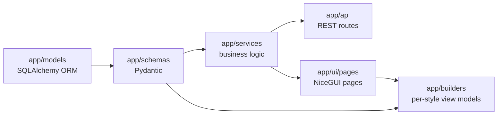
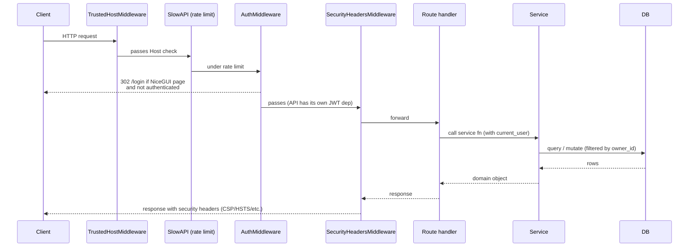

# Architecture

- [Stack](#stack)
- [Layer overview](#layer-overview)
- [Request lifecycle](#request-lifecycle)
- [Character-sheet rendering](#character-sheet-rendering)
- [State of the database](#state-of-the-database)

## Stack

- FastAPI — REST API surface (`/api/*`)
- NiceGUI — server-rendered reactive UI (`/login`, `/`, `/character/{id}`, ...)
- SQLAlchemy async ORM — SQLite in dev, PostgreSQL-ready
- JWT HttpOnly cookie — auth for API; NiceGUI's `app.storage.user` for page session

## Layer overview



Rules:

- Models never import from services or schemas.
- Schemas never import from services.
- Services own all DB writes and authorization checks.
- UI pages and API routes both go through services — never query the ORM directly.

## Request lifecycle



Public allow-list (in `app/ui/middleware.py`): `/login`, `/register`, plus prefixes `/_nicegui`, `/api/`, `/_static`.
API routes are exempt from the NiceGUI session check because they carry their own JWT cookie verified by `get_current_user` in `app/api/deps.py`. `SecurityHeadersMiddleware` is registered last in `main.py` so it stamps headers on every response — including auth redirects and rate-limit 429s.

## Character-sheet rendering

The `Character` Pydantic schema is the source of truth for a character. The page renders a per-style **view model** rather than the raw schema:

```mermaid
flowchart LR
  CR[CharacterRecord<br/>character_data: JSON] -->|Character&#40;**dict&#41;| CS[Character schema]
  CS --> GB[get_builder&#40;cs&#41;]
  GB -->|DnD5e / A5e / Shadowdark| VD[view_data dict]
  GB -.->|UM5 / GeneFunk / Carbon| NI[NotImplementedError]
  VD --> R[card renderers<br/>app/ui/components/sheet/*]
  R --> UI[NiceGUI tree]
```



- `app/builders/base.py` defines `BaseSheetBuilder` and the default `build_*` methods. Style-specific builders override only what they need (e.g. Shadowdark suppresses combat maneuvers). `app/builders/__init__.py` provides a `get_builder()` registry that maps `SheetStyle` to the correct builder class. The `SheetStyle` enum currently has six values (`DND5E`, `A5E`, `UM5`, `SHADOWDARK`, `GENEFUNK`, `CARBON`), but only DND5E, A5E, and SHADOWDARK have concrete builders — the others raise `NotImplementedError` from `get_builder()`.
- Card renderers live in `app/ui/components/sheet/` (abilities, actions, skills, hp, defenses, proficiencies, description, equipment, plus the `features` dispatcher that routes to `features_abilities`, `features_magic`, and `features_maneuvers`). Each is wrapped in `@ui.refreshable`. The orchestrator in `app/ui/pages/character_sheet.py` collects every refresh handle into `refresh_fns`. The single write path `_save(updates)` calls `update_character` then iterates `refresh_fns` to re-render every card — this is how attribute edits propagate to dependent cards (skills, defenses, magic DC, actions, etc.) without per-card wiring.
- `_compute_ac(character)` in `base.py` derives total AC from equipped inventory. An equipped armor item's `base_ac` replaces the manual AC base and its `dex_cap` clamps DEX contribution. Shields stack their `base_ac` on top. The breakdown is emitted as `view_data['ac_breakdown']`.
- Features and Equipment tabs bind their active-tab value to the page `state` dict via `bind_value()`, so the selected tab survives save-triggered re-renders.
- Cards with variable-length content (Features, Equipment, Actions) are height-capped at 400px with `overflow-y: auto` so the overall sheet layout stays compact.

## Character Import / Export

Characters can be exported as JSON from the character management page (`/characters`). The export envelope is versioned:

```json
{"version": 3, "exported_at": "...", "name": "...", "style": "dnd5e", "character_data": {...}}
```

Import reads the envelope, validates `character_data` against the `Character` Pydantic schema, overrides `owner_id` for security, and creates a new `CharacterRecord` with a fresh UUID. The `version` field enables future schema migration during import.

API endpoints: `GET /api/characters/{id}/export`, `POST /api/characters/import`. Service functions: `export_character()`, `import_character()` in `character_service.py`.

## State of the database

Tables are created lazily at startup via `Base.metadata.create_all` in `main.py`. The Alembic versions directory is empty — the SQLite dev DB can be deleted and rebuilt at any time. The `alembic.ini` is configured for the future move to PostgreSQL, where migrations will become the system of record.

On startup, if any of the six core global lookup tables (`global_class`, `global_skill`, `global_attribute`, `global_weapon`, `global_armor`, `global_item`) is empty, `app/cli/ingest.py` is invoked against `data/` to populate them — keeping the app usable out-of-the-box on a fresh DB. Four newer tables (`global_ability`, `global_combat_maneuver`, `global_spell`, `global_destiny`) have ORM definitions but no CSV loader yet; they remain empty until populated manually.
