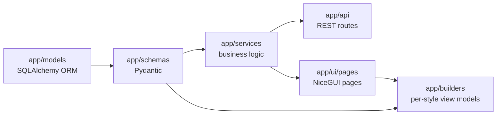
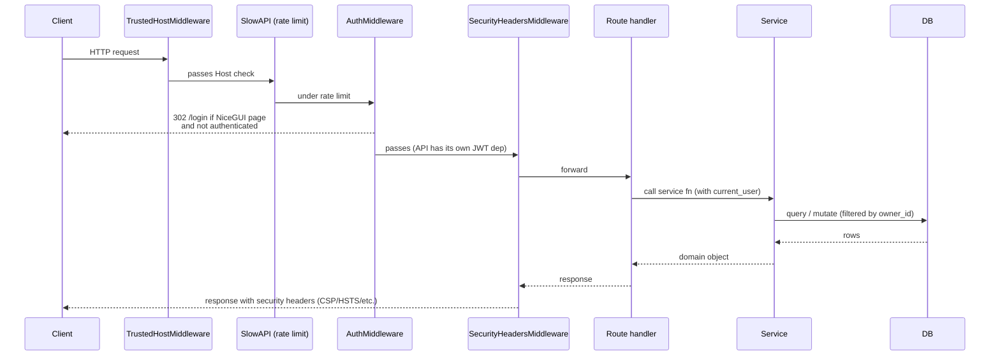

# Architecture

- [Stack](#stack)
- [Layer overview](#layer-overview)
- [Request lifecycle](#request-lifecycle)
- [Character-sheet rendering](#character-sheet-rendering)
- [State of the database](#state-of-the-database)

## Stack

- FastAPI — REST API surface (`/api/*`)
- NiceGUI — server-rendered reactive UI (`/login`, `/`, `/character/{id}`, ...)
- SQLAlchemy async ORM — SQLite in dev, PostgreSQL-ready
- JWT HttpOnly cookie — auth for API; NiceGUI's `app.storage.user` for page session

## Layer overview



Rules:

- Models never import from services or schemas.
- Schemas never import from services.
- Services own all DB writes and authorization checks.
- UI pages and API routes both go through services — never query the ORM directly.

## Request lifecycle



Public allow-list (in `app/ui/middleware.py`): `/login`, `/register`, plus prefixes `/_nicegui`, `/api/`, `/_static`.
API routes are exempt from the NiceGUI session check because they carry their own JWT cookie verified by `get_current_user` in `app/api/deps.py`. `SecurityHeadersMiddleware` is registered last in `main.py` so it stamps headers on every response — including auth redirects and rate-limit 429s.

### Static assets

`main.py` mounts `app/static/` at `/_static` via `app.add_static_files('/_static', 'app/static')`. The path falls under the public allow-list above so vendored CSS / fonts load without auth. Vendored third-party content (currently the homebrewery PHB CSS used to PHB-style the Allies and Notes markdown) lives at `app/static/vendor/<project>/`, with its upstream `LICENSE` next to it; see `THIRD_PARTY_LICENSES.md` at the repo root for the project-level summary. The file actually served is `phb.scoped.css` — a derivative produced by `app/static/vendor/homebrewery/scope_phb_css.py` that wraps every selector under a `.phb` ancestor (the upstream `phb.standalone.css` ships an unscoped Eric Meyer reset that would otherwise leak globally). The standalone original is kept in-tree as the source of truth so the scoper can be re-run on future upstream updates. The `<link>` is emitted from `app/ui/theme.py::apply_global_styles()`, where a small donjondocs-specific override block also relaxes PHB's printed-page geometry (column count, fixed page height) so markdown flows naturally inside our cards. The toggle that adds `.phb` to the markdown elements is on the character sheet top bar, persisted per logged-in user via `app.storage.user["phb_style"]`.

## Character-sheet rendering

The `Character` Pydantic schema is the source of truth for a character. The page renders a per-style **view model** rather than the raw schema:

```mermaid
flowchart LR
  CR[CharacterRecord<br/>character_data: JSON] -->|Character&#40;**dict&#41;| CS[Character schema]
  CS --> GB[get_builder&#40;cs&#41;]
  GB -->|DnD5e / A5e / Shadowdark| VD[view_data dict]
  GB -.->|UM5 / GeneFunk / Carbon| NI[NotImplementedError]
  VD --> R[card renderers<br/>app/ui/components/sheet/*]
  R --> UI[NiceGUI tree]
```



- `app/builders/base.py` defines `BaseSheetBuilder` and the default `build_*` methods. Style-specific builders override only what they need (e.g. Shadowdark suppresses combat maneuvers). `app/builders/__init__.py` provides a `get_builder()` registry that maps `SheetStyle` to the correct builder class. The `SheetStyle` enum currently has six values (`DND5E`, `A5E`, `UM5`, `SHADOWDARK`, `GENEFUNK`, `CARBON`), but only DND5E, A5E, and SHADOWDARK have concrete builders — the others raise `NotImplementedError` from `get_builder()`.
- Card renderers live in `app/ui/components/sheet/` (abilities, actions, skills, hp, defenses, proficiencies, description, equipment, plus the `features` dispatcher that routes to `features_abilities`, `features_magic`, and `features_maneuvers`). Each is wrapped in `@ui.refreshable`. The orchestrator in `app/ui/pages/character_sheet.py` collects every refresh handle into `refresh_fns`. The single write path `_save(updates)` calls `update_character` then iterates `refresh_fns` to re-render every card — this is how attribute edits propagate to dependent cards (skills, defenses, magic DC, actions, etc.) without per-card wiring.
- `_compute_ac(character)` in `base.py` derives total AC from equipped inventory. An equipped armor item's `base_ac` replaces the manual AC base and its `dex_cap` clamps DEX contribution. Shields stack their `base_ac` on top. The breakdown is emitted as `view_data['ac_breakdown']`.
- Features and Equipment tabs bind their active-tab value to the page `state` dict via `bind_value()`, so the selected tab survives save-triggered re-renders.
- Cards with variable-length content (Features, Equipment, Actions) are height-capped at 400px with `overflow-y: auto` so the overall sheet layout stays compact.

### Page tabs (Character / Allies / Notes)

The character sheet hosts three sibling pages under one URL (`/character/{id}`):

- **Character** — the existing card grid (abilities, HP, equipment, etc.).
- **Allies & Stat Blocks** — `app/ui/components/sheet/allies.py`.
- **Notes** — `app/ui/components/sheet/notes.py`.

Switching is implemented with `ui.tabs` + `ui.tab_panels` mounted just below the sticky top-bar — no router changes, no new URLs. The active tab is stored in `state["active_page"]` so a top-level `_save()` re-render can't snap users back to the Character tab.

Allies and notes are persisted in their own tables (`character_allies`, `character_notes`) rather than inside the `character_data` JSON blob, so each row is independently sortable, edited one-at-a-time, and gets DB-side `created_at` / `updated_at`. Both bodies are Markdown — rendered via `ui.markdown` on expand, edited in a `ui.textarea` with a "Markdown supported" hint. Writes go through `app/services/ally_service.py` and `app/services/note_service.py`, which both gate on `character_service.get_character` for ownership/admin RBAC.

## Creature Catalog

A second markdown-authored domain object — the **Creature Catalog** — lives independently of any character. The page at `/creatures` lists every creature visible to the current user; visibility = `is_public OR owner_id == me` (same filter shape the global-items service uses for vendor-vs-user-owned globals). Each row carries denormalised search metadata (size, comma-joined creature types, CR, habitat, `columns` for 1- vs 2-column display) alongside a PHB-style markdown `body_md`.

Pipeline:

```
POST /api/creatures (form / import / copy)
  → CreatureCreate                     # validated payload
  → creature_service.create_creature  # sets owner_id, returns ORM row
  → GET /api/creatures                 # visible-to-me query, owner_username denormalised
  → ui/pages/creatures.py              # flex-wrap grid, click-to-expand, .phb markdown
```

Files: `app/models/creature.py` (one table, FK `users.id` with `ondelete=CASCADE`), `app/schemas/creature.py`, `app/services/creature_service.py` (CRUD + visibility + copy-resets-public), `app/services/creature_io.py` (versioned envelope, `EXPORT_VERSION = 1`, fresh chain — never crosses with the character envelope), `app/services/creature_parser.py` (tolerant homebrewery-style stat-block parser that the "Update from stat block" button calls), `app/api/creature_routes.py` (REST surface at `/api/creatures`), `app/ui/pages/creatures.py` (the grid page).

Two design rules:

- **`is_public` is never trusted from an envelope or copy.** Both `import` and `copy_creature` force the new row to `is_public = False` so the importer / copier opts into sharing explicitly.
- **Edit-only-if-owner** (or admin). The catalog page hides the edit/delete buttons on rows the current user doesn't own; the service layer enforces the same constraint server-side, so a hand-crafted PATCH from a non-owner returns 403.

The catalog reuses the homebrewery PHB CSS (see "Static assets" above) for stat-block rendering. The per-creature `columns` field decorates the markdown wrapper with `.phb.phb-cols-2`, which unmasks the upstream two-column layout that the donjondocs override otherwise pins to a single column.

## Character Import / Export

Characters can be exported as JSON from the character management page (`/characters`). The export envelope is versioned:

```json
{
  "version": 6,
  "exported_at": "...",
  "name": "...",
  "style": "Dungeons & Dragons 5e",
  "character_data": {...},
  "allies": [{"name": "...", "ally_type": "...", "body_md": "..."}],
  "notes":  [{"title": "...", "body_md": "..."}]
}
```

Import reads the envelope, validates `character_data` against the `Character` Pydantic schema, overrides `owner_id` for security, and creates a new `CharacterRecord` with a fresh UUID. Allies and notes are validated against `AllyCreate` / `NoteCreate` and inserted with the new character's id. The `version` field walks the migration chain in `app/services/character_io.py::_MIGRATIONS` so older exports (v3, v4, v5) still import cleanly; v3-v5 envelopes simply land with empty `allies` / `notes` lists.

API endpoints: `GET /api/characters/{id}/export`, `POST /api/characters/import`. Service functions: `export_character()`, `import_character()` in `character_service.py`.

## State of the database

Tables are created lazily at startup via `Base.metadata.create_all` in `main.py`. The Alembic versions directory is empty — the SQLite dev DB can be deleted and rebuilt at any time. The `alembic.ini` is configured for the future move to PostgreSQL, where migrations will become the system of record.

On startup, if any of the six core global lookup tables (`global_class`, `global_skill`, `global_attribute`, `global_weapon`, `global_armor`, `global_item`) is empty, `app/cli/ingest.py` is invoked against `data/` to populate them — keeping the app usable out-of-the-box on a fresh DB. Four newer tables (`global_ability`, `global_combat_maneuver`, `global_spell`, `global_destiny`) have ORM definitions but no CSV loader yet; they remain empty until populated manually.
