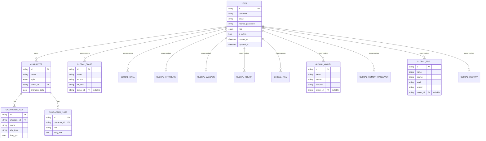

# Database

- [Engine](#engine)
- [Persistent tables](#persistent-tables)
- [ER diagram](#er-diagram)
- [Character data blob](#character-data-blob)

## Engine

- Dev: `sqlite+aiosqlite:///./donjondocs.db` (default in `.env.example`).
- Prod target: PostgreSQL (driver agnostic — set `DATABASE_URL` to a `postgresql+asyncpg://...` URL).
- All sessions are async (`async_session_factory` in `app/database.py`).

## Persistent tables

All tables that mix in `TimestampMixin` also carry `created_at` and `updated_at` audit columns; those are omitted from the per-table key-field list below to keep it readable.

| Table | Purpose | Key fields |
| --- | --- | --- |
| `users` | Accounts with RBAC | `id`, `username`, `email`, `hashed_password`, `role`, `is_active`, `last_login` (+ audit fields from `TimestampMixin`) |
| `characters` | Character records — most state is in JSON blob | `id`, `name`, `style`, `owner_id` (FK users), `character_data` (JSON) |
| `character_allies` | Per-character allies, companions, stat blocks (Markdown bodies) | `id`, `character_id` (FK characters, ON DELETE CASCADE), `name`, `ally_type` (free text), `body_md` |
| `character_notes` | Per-character free-form notes (Markdown bodies) | `id`, `character_id` (FK characters, ON DELETE CASCADE), `title`, `body_md` |
| `global_class` | System-defined classes (per `source`) | `id`, `name`, `description`, `reference`, `hit_dice`, `primary_ability`, `saving_throws`, `proficiencies`, `source`, `owner_id` (NULL = global) |
| `global_skill` | System-defined skills | `id`, `name`, `attribute`, `example_uses`, `specialties`, `reference`, `source`, `owner_id` |
| `global_attribute` | System-defined ability scores | `id`, `name`, `alias` (e.g. `STR`), `description`, `reference`, `source`, `owner_id` |
| `global_weapon` | System-defined weapons | `id`, `name`, `description`, `reference`, `type`, `damage`, `damage_type`, `range`, `weight`, `value`, `notes`, `effects`, `source`, `owner_id` |
| `global_armor` | System-defined armor | `id`, `name`, `description`, `reference`, `type`, `armor_class`, `base_ac`, `dex_cap`, `is_shield`, `strength_requirement`, `disadvantage_on_stealth`, `weight`, `value`, `notes`, `effects`, `source`, `owner_id` |
| `global_item` | System-defined gear / consumables | `id`, `name`, `description`, `reference`, `type`, `weight`, `value`, `effects`, `is_container`, `is_equipable`, `is_consumable`, `is_attunable`, `source`, `owner_id` |
| `global_ability` | Class/race features and feats | `id`, `name`, `description`, `reference`, `features`, `source`, `owner_id` |
| `global_combat_maneuver` | A5e maneuvers | `id`, `name`, `description`, `reference`, `tradition`, `exertion`, `activation`, `tier`, `source`, `owner_id` |
| `global_spell` | Spell catalog | `id`, `name`, `description`, `reference`, `level`, `school`, `classes`, `casting_time`, `range`, `components`, `duration`, `ritual`, `concentration`, `source`, `owner_id` |
| `global_destiny` | A5e destinies | `id`, `name`, `description`, `reference`, `src_inspiration`, `inspiration_feat`, `fullfillment`, `source`, `owner_id` |

`owner_id` is `NULL` for entries seeded from `data/` (visible to all users). User-defined custom entries set `owner_id` to that user; lookups filter `OR owner_id IS NULL`. The `source` column carries the rule-system identifier (e.g. `Dungeons & Dragons 5e`, `Level Up: Advanced 5e`, `Shadowdark RPG`) — it's set by `app/cli/ingest.py` from the CSV filename.

Note: `global_ability`, `global_combat_maneuver`, `global_spell`, and `global_destiny` are defined in the ORM but `app/cli/ingest.py` does not yet have CSV loaders for them; they remain empty until populated through another path.

## ER diagram

(Other `Global*` tables follow the same shape as `GLOBAL_CLASS` — `id` / `name` / `source` / `owner_id` plus their type-specific columns; only a few are drawn explicitly to keep the diagram readable.)

## Character data blob

Most character state lives in `characters.character_data` (JSON). The shape is the `Character` Pydantic schema (`app/schemas/char_sheet_specific.py`). Top-level keys include:

| Key | Type | Notes |
| --- | --- | --- |
| `name`, `style`, `owner_id`, `race`, `background`, `destiny`, `speed`, `size` | scalars / dicts | Identity & top bar |
| `prof_bonus` | `int` | Auto-derived from total level and style; not user-editable |
| `classes` | `list[CharacterClassEntry]` | Authoritative multiclass list — `level` and `character_class` are denormalized cache fields synced by `_sync_classes_and_level` validator |
| `str_score` ... `cha_score` | `AbilityScore` | Six fixed ability fields with `base / racial / level / misc` parts |
| `saving_throws`, `skills`, `abilities`, `actions` | lists | Inline character widgets |
| `magic_resources`, `spells`, `combat_maneuvers` | lists | Style-dependent — Shadowdark omits maneuvers. Each magic resource may carry an optional `extra_resource` (name, current, maximum, reset_on) for class-specific pools like sorcery points. Spells include casting_time, duration, spell_range, ritual, concentration. Combat maneuvers include degree, tradition, exertion_cost, action_type, stance |
| `known_traditions`, `exertion_current`, `exertion_max`, `maneuvers_known`, `max_degree`, `maneuver_attack_misc`, `maneuver_dc_misc` | scalars | A5e combat maneuver header — exertion pool resets on short rest, DC/attack derived in builder from `max(STR, DEX) + prof + misc` |
| `inventory` | `list[InventoryItem]` | Weapons / armor / items; display fields denormalized at add time. Armor items carry `base_ac`, `dex_cap`, `is_shield` for AC computation |
| `equipment` | `CharacterEquipment` | Currently holds `money: dict[currency_code, amount]` |
| `personality`, `ideals`, `bonds`, `flaws`, `appearance`, `backstory` | `str` | Free-text roleplay fields (default `""`) |
| `age`, `gender`, `height`, `weight`, `eyes`, `hair`, `skin`, `alignment`, `title`, `deity` | `str` | Physical/identity description fields (default `""`, hidden when empty) |
| `hp_current`, `hp_max`, `hp_temp`, `exhaustion`, `strife`, `death_save_successes`, `death_save_failures`, `inspiration`, `conditions`, `resistances`, `immunities`, `vulnerabilities` | scalars / lists | Combat state (resistances/immunities/vulnerabilities are free-text strings; `strife` is the A5e-only Strife track, 0–6; `death_save_successes`/`death_save_failures` are 0–3 counters, suppressed in Shadowdark) |
