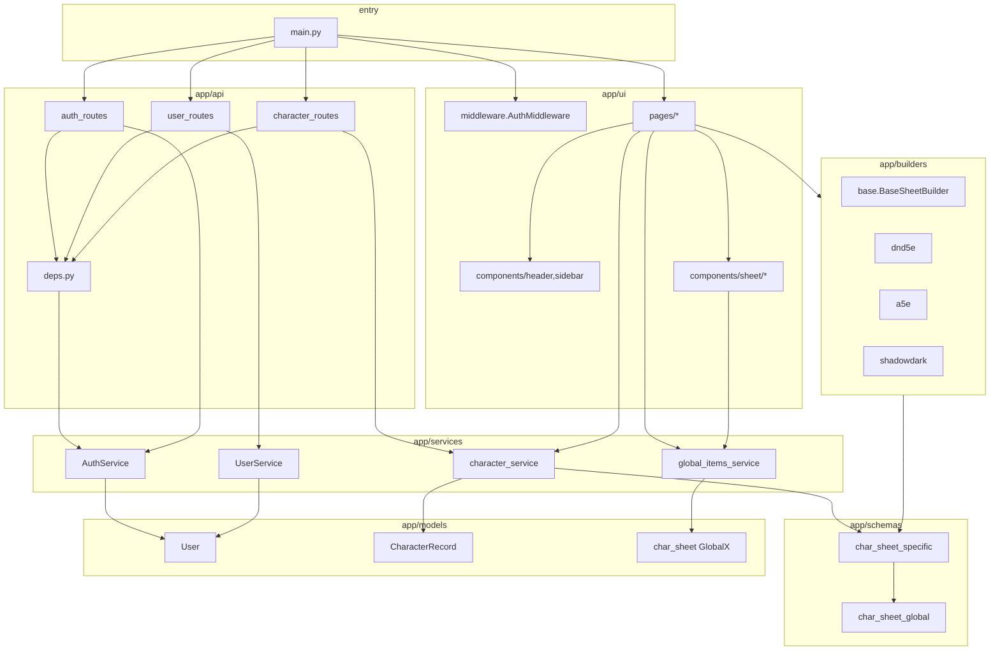

# Component dependencies

- [Module graph](#module-graph)
- [Narrative](#narrative)

## Module graph

## Narrative

- **Builders depend only on schemas.** They never touch the DB. A builder converts a `Character` schema into a plain dict view-model the UI cards consume. This makes them trivial to unit-test in isolation.
- **Services depend on models + schemas, not on UI or API.** They own all DB writes and authorization. Both UI pages and API routes funnel through services — never query the ORM directly.
- **API depends on services + Pydantic request bodies.** Each route is thin: parse, call a service, translate exceptions to HTTP.
- **UI depends on services + builders.** The character sheet orchestrator (`app/ui/pages/character_sheet.py`) delegates rendering to card components in `app/ui/components/sheet/`. Each card's `_section` refresh handle is collected and re-rendered on save (the "refresh-all" pattern). The single write path is `_save(updates)` in `character_sheet.py`.
- **Models depend on the database layer only.** They never import schemas or services.
- **Middleware depends on `nicegui.app`** for storage and lives outside the service stack. It is the only auth guard for UI pages; API routes use the JWT dep in `app/api/deps.py`.
- **NiceGUI is pinned `>=3.12,<4`** (`requirements.txt`). Bumped from 3.10 for the 3.12 security fix (unauthenticated DoS on dynamic-resource/ESM routes) plus stability fixes that touch our code paths: silent window reloads on WebSocket reconnect (long-lived character sheet), a `ValidationElement.validate()` KeyError (we use `validation=` on login/register/profile), a Windows `PermissionError` during `app.storage.user` cleanup, and unbounded streaming-cookie memory growth. No API breakage applied (audited). Conventions: `docs/nicegui.md`.
