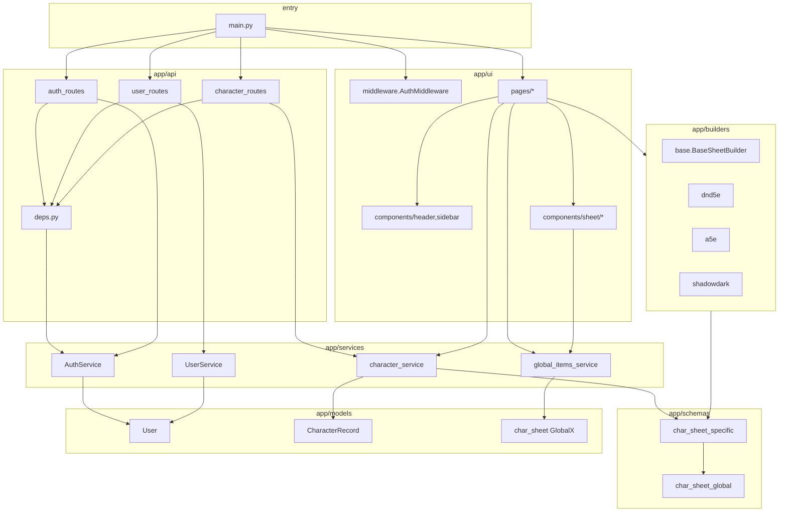

# Component dependencies

- [Module graph](#module-graph)
- [Narrative](#narrative)

## Module graph



## Narrative

- **Builders depend only on schemas.** They never touch the DB. A builder converts a `Character` schema into a plain dict view-model the UI cards consume. This makes them trivial to unit-test in isolation.
- **Services depend on models + schemas, not on UI or API.** They own all DB writes and authorization. Both UI pages and API routes funnel through services — never query the ORM directly.
- **API depends on services + Pydantic request bodies.** Each route is thin: parse, call a service, translate exceptions to HTTP.
- **UI depends on services + builders.** The character sheet orchestrator (`app/ui/pages/character_sheet.py`) delegates rendering to card components in `app/ui/components/sheet/`. Each card's `_section` refresh handle is collected and re-rendered on save (the "refresh-all" pattern). The single write path is `_save(updates)` in `character_sheet.py`.
- **Models depend on the database layer only.** They never import schemas or services.
- **Middleware depends on `nicegui.app`** for storage and lives outside the service stack. It is the only auth guard for UI pages; API routes use the JWT dep in `app/api/deps.py`.
- **NiceGUI is pinned `>=4.0,<5`** (`requirements.in`). Upgraded from 3.15 to 4.0.0 (removes 3.x deprecations, updates bundled Quasar to 2.35, narrows text input values to `str`, drops `lxml`/`lxml-html-clean`, cuts per-client memory ~14%, adds `httpx2`). Recompiling the lockfiles alongside the bump also resolved `pyjwt` CVE-2026-102265 (`2.13.0` → `2.15.1`) and `aiohttp` CVE-2026-128125/128126 (`3.14.3` → `3.14.5`). Full unit/integration (408 tests) and Playwright E2E (5 browser flows) suites verified against 4.0.0. Conventions: `docs/nicegui.md`.

## Dependency management (pinned lockfile workflow)

Dependencies are managed with **pip-tools**. Intent is authored in `requirements.in`
/ `requirements-dev.in` / `requirements-e2e.in`; the committed `requirements*.txt`
files are **generated, fully-pinned lockfiles — do not hand-edit them.** To change a
dependency, edit the `.in` and recompile on **Python 3.14** (the Render runtime),
so resolved versions match production:

```bash
pip install pip-tools
pip-compile --strip-extras requirements.in     -o requirements.txt
pip-compile --strip-extras requirements-dev.in -o requirements-dev.txt
pip-compile --strip-extras requirements-e2e.in -o requirements-e2e.txt
```

Tests run in a **clean venv** built from those lockfiles via `nox` (and the same
`nox` session in CI, `.github/workflows/tests.yml`), so a broken or incomplete pin
fails the test run rather than only surfacing on a Render deploy. Run `nox` for the
authoritative pass; bare `pytest` is fine for fast local iteration. Browser E2E
tests live in `tests/e2e/` and run separately via `nox -s e2e`.

## Dependency risks (tracked)

The pinned lockfiles resolve to current releases. Two standing
`DeprecationWarning`s are upstream Python-3.14 deprecations correctly silenced in
`pytest.ini`; do **not** treat them as fixable by upgrading:

- **`slowapi` Python 3.16 compatibility.** Currently at `0.1.10` (June 2026).
  `slowapi/extension.py` still calls `asyncio.iscoroutinefunction`, which Python
  **3.14 deprecates and 3.16 removes**. On 3.16 the rate limiter would *break*,
  not just warn, unless upstream ships a fix. **Action when 3.16 nears:** vendor
  a one-line patch (`inspect.iscoroutinefunction`), swap the limiter, or hold
  Python `<3.16`.
- **`markdown2` (`2.5.5`, transitive via `nicegui`).** Advisory CVE-2026-118694
  (quadratic ReDoS on unclosed `[a](` sequences) affects `<=2.5.5`, and `2.5.5`
  is currently the latest release on PyPI (`pip-audit` reports zero fixable
  advisories). Recompile `requirements.txt` as soon as upstream publishes a
  patched `markdown2` release.
- **`pytest-asyncio` (`1.5.0`)** moved to loop factories; `pytest.ini` sets
  `asyncio_default_fixture_loop_scope = function` and keeps the
  `event_loop_policy` warning filters until Python 3.14 warnings are fully gone.
- **Auth hashing migrated off `passlib` (done).** `app/security.py` now hashes
  new passwords with **argon2id** (`argon2-cffi`) and verifies legacy bcrypt
  hashes directly via the maintained **`bcrypt`** library. `authenticate_user`
  calls `needs_rehash()` to transparently upgrade any surviving bcrypt hash to
  argon2 on the next successful login, so no existing user is locked out. This
  removed unmaintained `passlib` (and the `bcrypt<5` cap it forced — bcrypt is
  now unpinned/`5.x`).
- **JWTs migrated off `python-jose` to `PyJWT` (done).** Dropped the semi-
  maintained `python-jose` and its `ecdsa`/`rsa` transitive crypto deps
  (`ecdsa` had an unfixable timing advisory, though the HS256-only code never
  exercised it).

The httpx per-request `cookies=` deprecation that *was* visible in the test
run came from our own tests, not a dependency — fixed by standardising on the
suite-wide `client.cookies = auth_cookies(user)` pattern (see
`tests/test_creature_routes.py`).
