# DonjonDocs Screenshot Gallery

A visual tour of DonjonDocs across its supported game systems, play-time sheet controls, PHB parchment styling, Creature Catalog, and self-hosted Admin Panel.

← Back to [README](../README.md)

---

## Multi-System Character Creation

Six game system cards on `/sheet/new` — clicking **Dungeons & Dragons 5e** opens a unified ruleset picker for **2024 Rules (SRD 5.2)** and **2014 Rules (SRD 5.1)** alongside Level Up: Advanced 5e, Shadowdark RPG, Ultramodern5, Voidrunner, and Shadowrun: Anarchy 2.0.

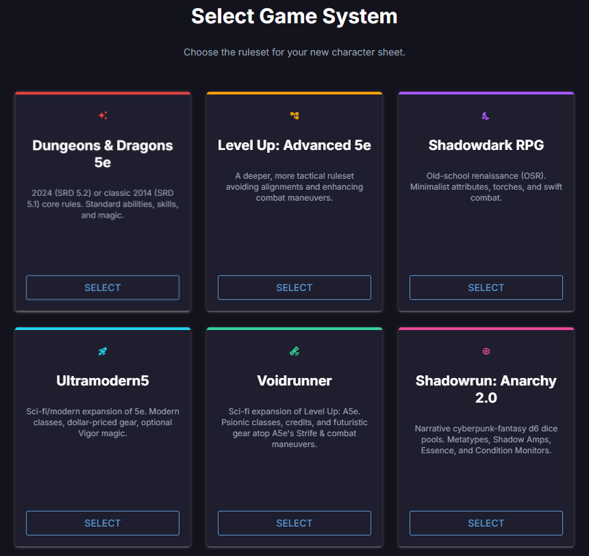

---

## 5e & Level Up: Advanced 5e Character Sheet

### Core Sheet & Sticky Top Bar
Live ability modifiers, saving throws, derived attack bonuses, skills with specialties, HP slider & `+/-` adjusters, Fatigue/Strife or Exhaustion tracks, death saves, defenses, and one-click **Short Rest** / **Long Rest** controls.

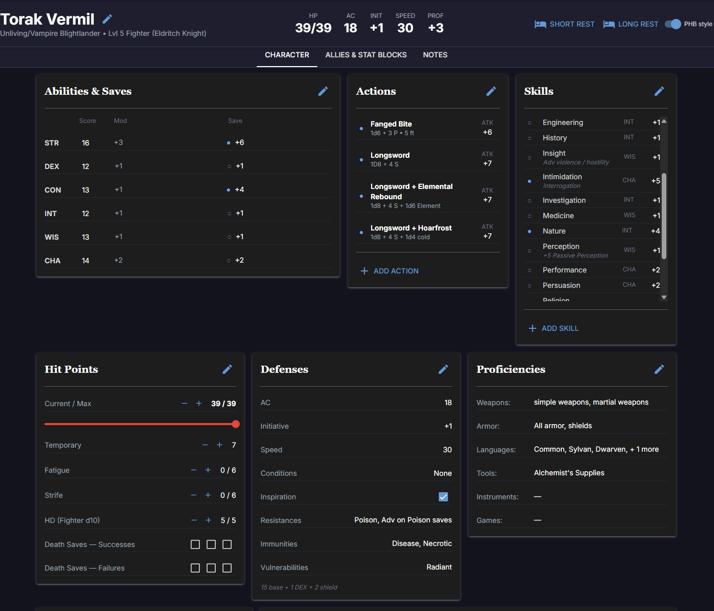

### D&D 5e (2024) Weapon Mastery Tracking
2024 sheets add a **Masteries** counter in the Equipment header (auto-scaled by class/level and editable for feats), a **`Ma`** toggle column alongside Equipped (`Eq`) and Attuned (`At`), amber **`Mastery: <Name>`** badges in Properties, and hover tooltips displaying the SRD 5.2 rule text.

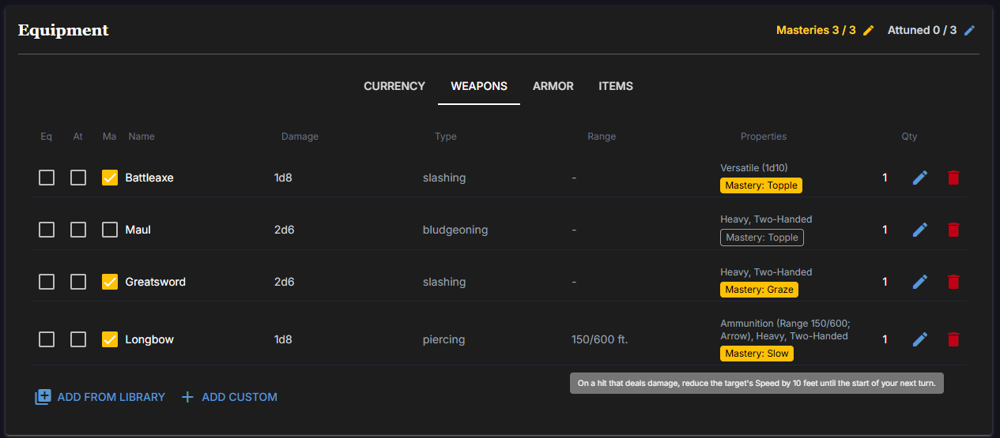

### Spells, Combat Maneuvers & Features
Dedicated tabbed cards for **Abilities / Features** (grouped by Heritage, Culture, Class, DM Gift, Feat), **Magic** (searchable spell library picker, prepared filter, spell attack/DC math), and **Combat Maneuvers** (Exertion tracker, maneuver DC/attack bonus, stances, and library picker for A5e & Voidrunner).

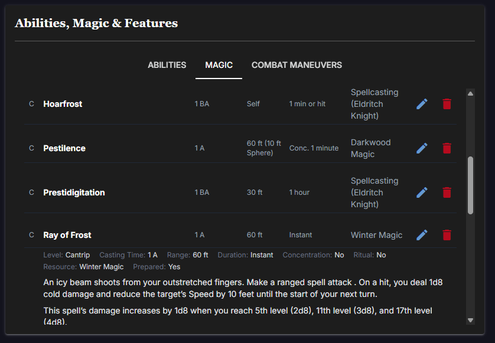

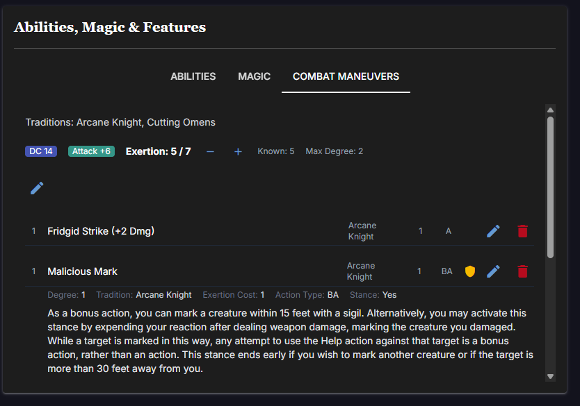

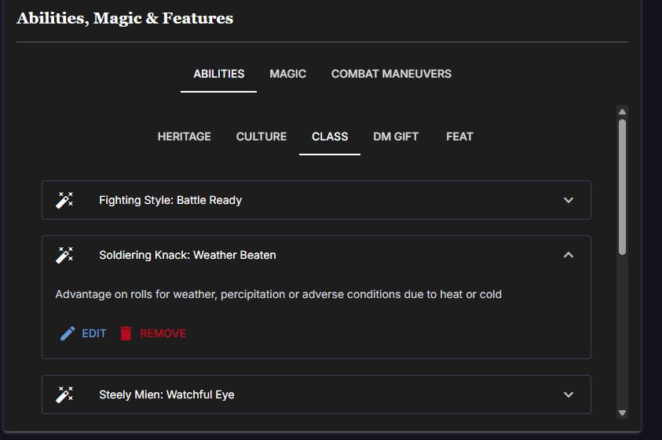

---

## Allies, Stat Blocks & Notes (PHB Parchment Style)

Toggle **PHB style** on any 5e-family sheet to render Markdown Allies, Companions, Mounts, Vehicles, and Session Notes in classic Player's Handbook parchment typography.

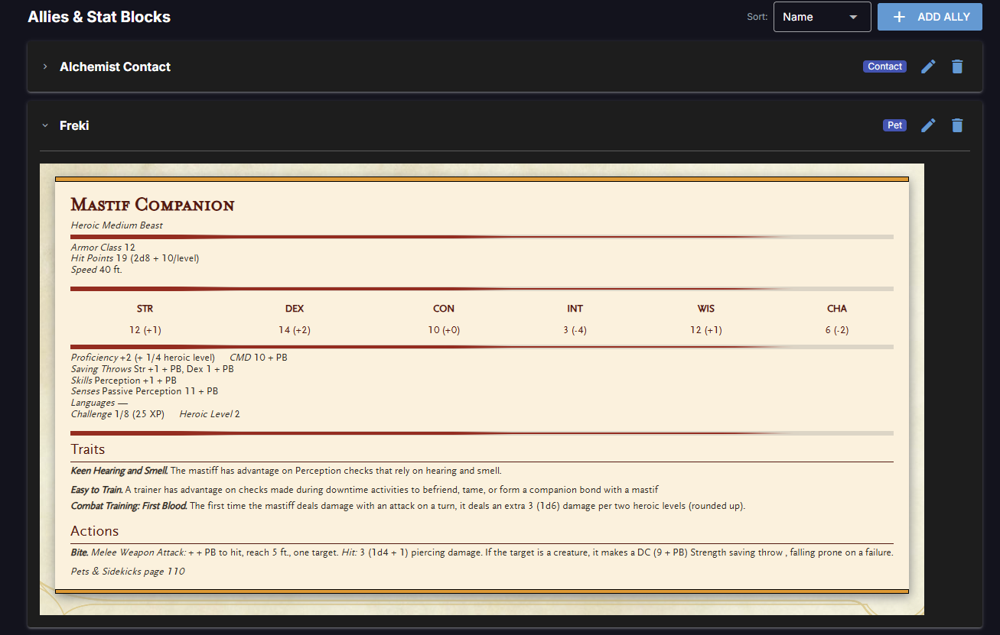

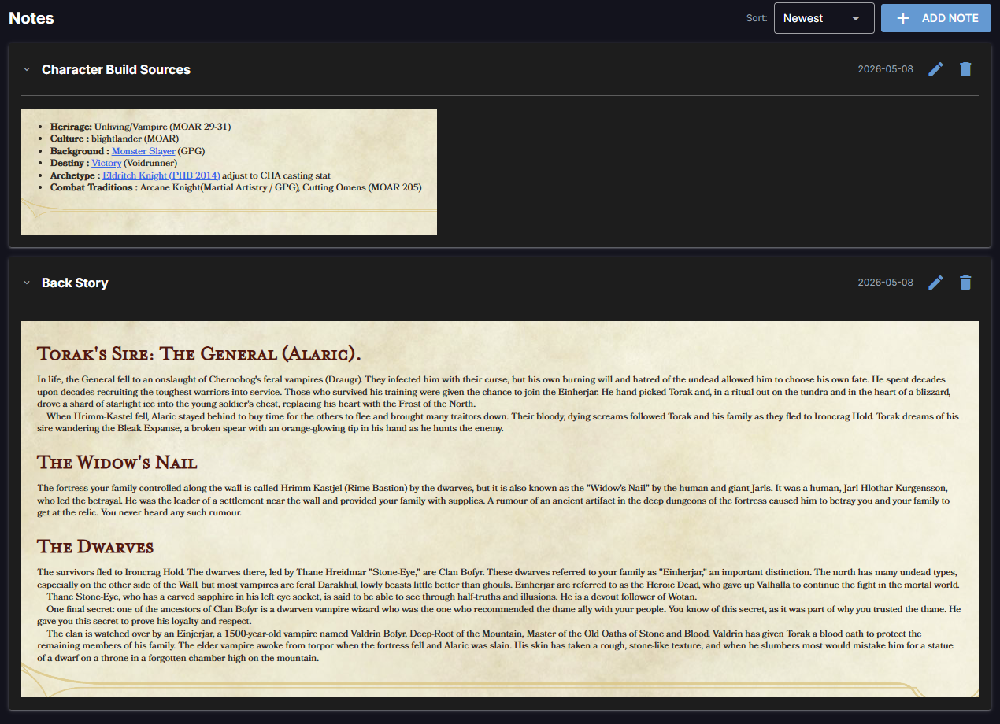

---

## Creature Catalog (2-Column PHB Layout)

Build a private or group-shared bestiary with 1-column or balanced **2-column** Homebrewery stat-block rendering, automatic stat-block metadata parsing, public/private sharing, and one-click copy/export.

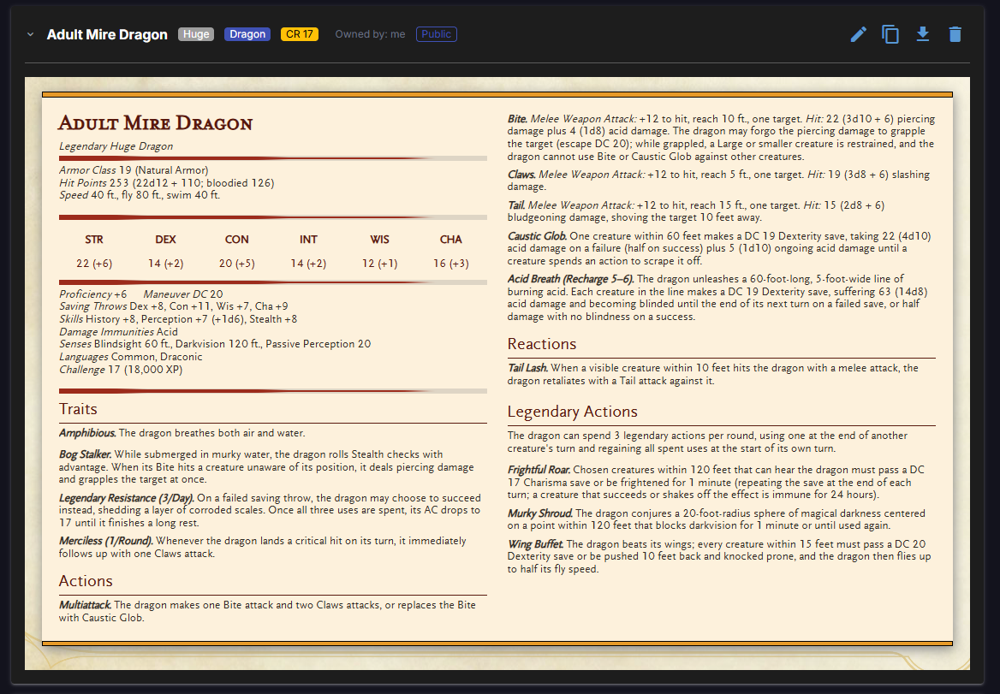

---

## Shadowrun: Anarchy 2.0 Sheet

Dedicated non-5e layout with metatype-capped attributes, Edge tracker & **New Run** reset, automatic Essence penalty tracking, Nuyen character-value audit, discrete Light/Serious/Incapacitated wound monitors, Skills with specializations & Risk Reduction, and Shadow Amps.

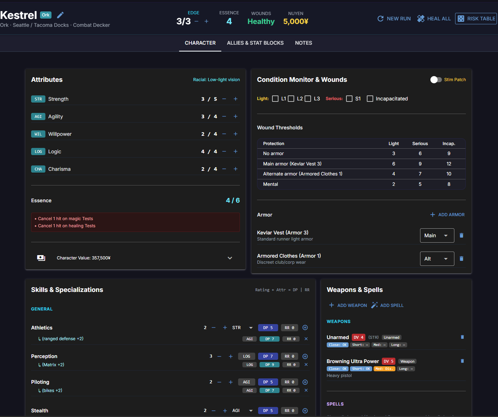

---

## Admin Panel

Self-hosted group management in one place: user creation & roles, per-system seeded rulebook counts across all 7 rulesets with one-click **Reseed Global Data**, and password-verified JSON **Database Backup** downloads.

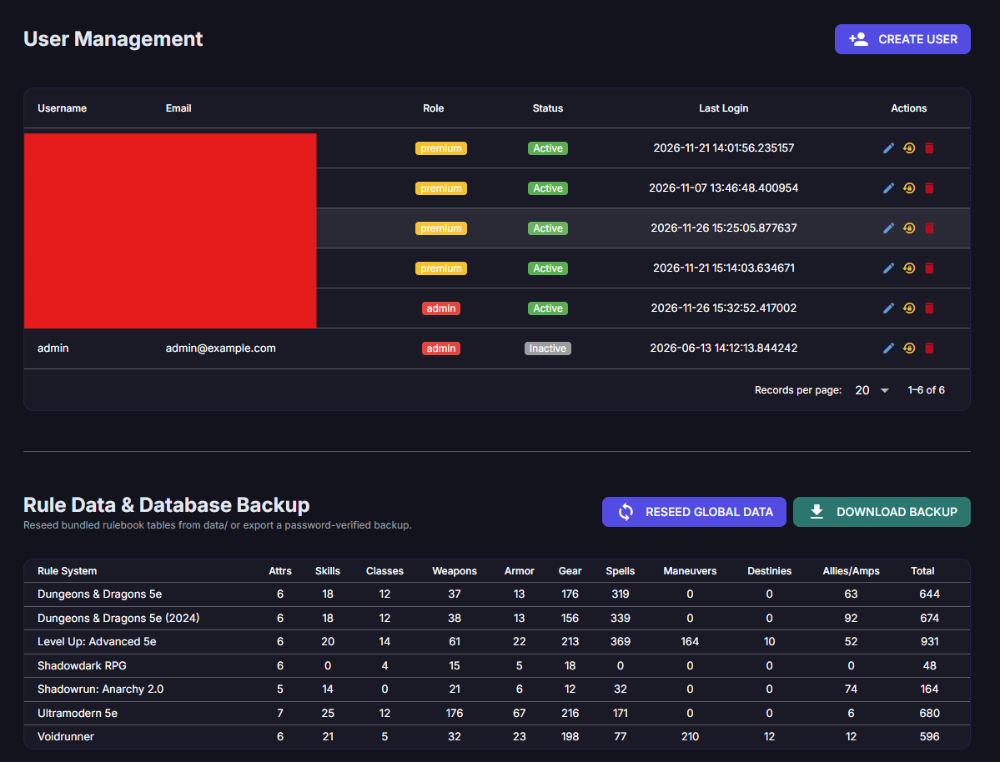
